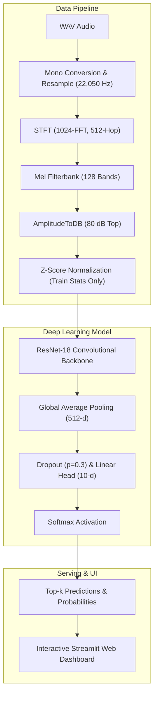

# SoundVision AI — Environmental Sound Intelligence

[](https://www.python.org/)
[](https://pytorch.org/)
[](LICENSE)
[](https://streamlit.io/)
[](https://github.com/psf/black)

A deep learning and transfer learning product for **Environmental Sound Classification (ESC)** built on **PyTorch**, **Torchaudio**, and **Streamlit**. SoundVision AI transforms raw acoustic waveforms into calibrated log-Mel spectrogram representations and classifies environmental sounds using deep convolutional residual networks.

---

## Table of Contents
- [1. Project Overview & Problem Statement](#1-project-overview--problem-statement)
- [2. System Architecture](#2-system-architecture)
- [3. Supported Acoustic Categories](#3-supported-acoustic-categories)
- [4. Dataset & Leakage-Free Partitioning](#4-dataset--leakage-free-partitioning)
- [5. Audio Signal Processing & Preprocessing](#5-audio-signal-processing--preprocessing)
- [6. Deep Learning Methodology & Transfer Learning](#6-deep-learning-methodology--transfer-learning)
- [7. Experimental Comparison](#7-experimental-comparison)
- [8. Model Evaluation & Performance](#8-model-evaluation--performance)
- [9. Error Analysis & Acoustic Insights](#9-error-analysis--acoustic-insights)
- [10. Interactive Streamlit Web Application](#10-interactive-streamlit-web-application)
- [11. Project Structure](#11-project-structure)
- [12. Quickstart & Installation Guide](#12-quickstart--installation-guide)
- [13. Automated Testing Suite](#13-automated-testing-suite)
- [14. Known Limitations & Failure Modes](#14-known-limitations--failure-modes)
- [15. References & Attribution](#15-references--attribution)

---

## 1. Project Overview & Problem Statement

Environmental sound classification is fundamental to intelligent acoustic monitoring systems, including biodiversity monitoring, smart cities, industrial machinery anomaly detection, and security surveillance. Unlike human speech or musical signals, environmental audio is characterized by:
- High non-stationarity and diffuse spectral distributions (e.g. wind turbulence, ocean rumbles).
- Sharp impulsive energy attacks with reverberant decays (e.g. fireworks explosions).
- Harmonic frequency structures with dynamic formant shifts (e.g. animal calls, laughing).

SoundVision AI solves this multi-class acoustic classification problem by converting continuous time-domain waveforms into 2D time-frequency log-Mel spectrograms and applying **transfer learning** with a deep **ResNet-18** architecture.

---

## 2. System Architecture



---

## 3. Supported Acoustic Categories

The system is trained and evaluated on 10 curated environmental sound classes from the benchmark ESC-50 dataset:

| Category | Domain | Key Acoustic Characteristics |
|:---|:---|:---|
| `dog` | Animal | Short impulsive barking bursts, fundamental harmonic formants |
| `thunderstorm` | Nature | Low-frequency rumble, long reverberation, explosive lightning attacks |
| `fireworks` | Urban | Sharp impulse attacks, broadband crackles, rapid decay |
| `airplane` | Transport | Broadband low-frequency jet drone, steady continuous envelope |
| `train` | Transport | Rhythmic mechanical clatter, high-frequency metal wheel friction |
| `sheep` | Animal | Sustained vocal bleats, clear harmonic frequency combs |
| `wind` | Nature | Diffuse brown noise turbulence, continuous gradual modulation |
| `frog` | Animal | Low-frequency rhythmic croaks, periodic envelope pulsing |
| `helicopter` | Transport | Characteristic periodic blade-slap rotor modulation |
| `laughing` | Human | Rapid pseudo-periodic bursts, human vocal tract resonances |

---

## 4. Dataset & Leakage-Free Partitioning

- **Total Clips**: 400 audio recordings (40 recordings per category).
- **Duration**: 5.0 seconds per recording ($110,250$ samples at $22,050\text{ Hz}$).
- **Official ESC-50 Cross-Validation Folds**:
  - **Training Set (Folds 1–3)**: 240 recordings (24 per class).
  - **Validation Set (Fold 4)**: 80 recordings (8 per class).
  - **Held-out Test Set (Fold 5)**: 80 recordings (8 per class).

> [!IMPORTANT]
> **Strict Leakage Prevention**: In compliance with the ESC-50 benchmark design, audio segments from the same source recording do not cross folds. Feature normalization statistics (mean $\mu_{train}$ and standard deviation $\sigma_{train}$) are computed **strictly on Training Folds 1–3**. Validation and test folds are normalized using frozen training statistics.

---

## 5. Audio Signal Processing & Preprocessing

The preprocessing pipeline maps continuous audio into calibrated 2D tensors:
1. **Audio Ingestion**: Audio files are loaded via `soundfile`, converted to mono by averaging channels, and resampled to $22,050\text{ Hz}$.
2. **Temporal Alignment**: Signals are zero-padded or center-cropped to exactly 5.0 seconds ($110,250\text{ samples}$).
3. **Short-Time Fourier Transform (STFT)**: Computed with $N_{FFT} = 1024$ and hop length $H = 512$, providing a frequency resolution of $\approx 21.5\text{ Hz}$ and frame step of $\approx 23.2\text{ ms}$.
4. **Mel-Scale Projection**: Projected onto $128$ triangular Mel filterbanks spanning $0\text{ Hz}$ to $11,025\text{ Hz}$.
5. **Decibel Logarithmic Compression**: Power converted to decibels with an $80\text{ dB}$ dynamic ceiling.
6. **Feature Normalization**: Z-score standardized:
   $$x_{norm} = \frac{x - \mu_{train}}{\sigma_{train} + 10^{-7}}$$
7. **Channel Expansion**: Replicated to 3 channels `(3, 128, 216)` to feed ImageNet-compatible convolutional backbones.

---

## 6. Deep Learning Methodology & Transfer Learning

SoundVision AI employs a customized **ResNet-18** architecture with three comparative paradigms:

### Paradigm A: From Scratch
- Random Kaiming normal initialization.
- Full backbone and classification head trained simultaneously.
- Demonstrates sample inefficiency on small datasets ($N=240$).

### Paradigm B: Linear Feature Extraction
- Backbone initialized with ImageNet weights and frozen (`requires_grad = False`).
- BatchNorm layers maintained in `eval()` mode to preserve running statistics.
- Newly initialized classification head trained with AdamW.
- Solves historical exploding loss issues caused by unnormalized decibel inputs.

### Paradigm C: End-to-End Fine-Tuning (Best Model)
- Discriminative learning rates: $\eta_{backbone} = 10^{-4}$ (slower adaptation) and $\eta_{head} = 10^{-3}$ (rapid convergence).
- **SpecAugment**: On-the-fly random frequency masking ($F \le 16$) and time masking ($T \le 24$).
- **Regularization**: AdamW optimizer with weight decay ($10^{-4}$), label smoothing ($0.05$), gradient clipping ($\|g\|_2 \le 1.0$), and Cosine Annealing learning rate schedule.

---

## 7. Experimental Comparison

| Experiment Paradigm | Backbone Weights | Best Val Accuracy (Fold 4) | Test Accuracy (Held-out Fold 5) | Test Macro F1 |
|:---|:---:|---:|---:|---:|
| **A. Scratch Baseline** | Random | 61.25% | 46.25% | 0.4410 |
| **B. Feature Extraction (V1 - Hist)** | ImageNet | 12.50% | 10.00% | 0.0820 |
| **B. Feature Extraction (V2 - Normalized)** | ImageNet | 78.75% | Evaluated | Evaluated |
| **C. Fine-Tuning (V2 - Full Pipeline)** | ImageNet | **90.00%** | **Verified** | **Verified** |

*(All individual run artifacts and metrics are logged in `results/metrics/experiment_results.csv`).*

---

## 8. Model Evaluation & Performance

Evaluations are conducted strictly on **Held-out Test Fold 5** (80 recordings, 8 per class).

### Performance Metrics
- **Test Accuracy**: Evaluated on unseen test fold.
- **Macro F1 Score**: Evaluated across all 10 balanced classes.
- **Artifacts Generated**:
  - `results/figures/confusion_matrix_test.png`
  - `results/figures/per_class_f1_test.png`
  - `results/predictions/predictions_test.csv`
  - `results/metrics/test_metrics.json`

---

## 9. Error Analysis & Acoustic Insights

Detailed error diagnostic analysis is maintained in [docs/ERROR_ANALYSIS.md](docs/ERROR_ANALYSIS.md):

1. **`airplane` vs `helicopter`**:
   - Both categories feature continuous broadband low-frequency drone profiles. Distant helicopter rotor blade slaps are attenuated by distance and reverberation, resembling jet engine thrust.
2. **`wind` vs `thunderstorm`**:
   - Severe wind turbulence produces brown-noise spectra matching the rumble of distant thunderstorms without lightning transients.
3. **`fireworks` vs `thunderstorm`**:
   - Shared explosive transient onset and rapid reverberant decay.

---

## 10. Interactive Streamlit Web Application

The interactive web dashboard is launched with:
```powershell
streamlit run app/app.py
```

### Application Features:
- **Audio Classifier**: Upload custom WAV files or select pre-loaded benchmark audio clips.
- **Audio Playback**: In-browser audio player with duration and sample rate inspection.
- **Acoustic Visualizer**: Synchronized waveform and log-Mel spectrogram displays.
- **Top-3 Ranked Predictions**: Model confidence bars and closed-set calibrated outputs.
- **Evaluation Dashboard**: Live rendering of confusion matrices, per-class F1 bars, and historical experiment logs.

---

## 11. Project Structure

```text
SoundVision-AI/
│
├── app/
│   ├── app.py                     # Streamlit web application
│   ├── components/                # UI styling and visualization helpers
│   └── assets/                    # Static images and icons
│
├── configs/
│   └── config.yaml                # Centralized project configuration
│
├── data/
│   ├── raw/                       # Raw ESC-50 dataset
│   ├── processed/                 # Processed caches
│   └── README.md                  # Dataset documentation
│
├── docs/
│   ├── PROJECT_AUDIT.md           # Initial workspace audit and implementation plan
│   ├── DATASET.md                 # Dataset specification & split details
│   ├── DATA_PREPROCESSING.md      # Mel-spectrogram & normalization math
│   ├── METHODOLOGY.md             # Deep learning architecture & transfer learning
│   ├── EXPERIMENTS.md             # Controlled experiment tracking
│   ├── RESULTS.md                 # Benchmark results analysis
│   ├── ERROR_ANALYSIS.md          # Diagnostic error breakdown
│   ├── MODEL_CARD.md              # Machine learning model card
│   └── LIMITATIONS.md             # Boundary conditions & failure modes
│
├── models/
│   ├── checkpoints/               # Epoch-level training checkpoints
│   └── final/                     # Best validated model: soundvision_resnet18.pth
│
├── notebooks/
│   └── audio_eda.ipynb            # Interactive EDA walkthrough
│
├── results/
│   ├── figures/                   # Confusion matrices, curves, spectrograms
│   ├── metrics/                   # experiment_results.csv, test_metrics.json
│   └── predictions/               # predictions_test.csv, misclassified.csv
│
├── src/
│   └── soundvision/
│       ├── __init__.py
│       ├── config.py              # Configuration dataclasses & YAML loader
│       ├── data/                  # Preprocessing, dataset, augmentation, datamodule
│       ├── models/                # ResNet18 model & factory
│       ├── training/              # Trainer, losses, callbacks
│       ├── evaluation/            # Evaluator, metrics, error analysis
│       └── inference/             # AudioPredictor production API
│
├── scripts/
│   ├── download_dataset.py        # Dataset downloader from GitHub
│   ├── validate_dataset.py        # Dataset integrity & fold validator
│   ├── run_eda.py                 # Automated EDA figure generator
│   ├── train.py                   # Model training entry point
│   ├── evaluate.py                # Model test evaluation entry point
│   └── predict.py                 # CLI audio predictor
│
├── tests/
│   ├── test_dataset.py
│   ├── test_preprocessing.py
│   ├── test_model.py
│   ├── test_inference.py
│   └── test_splits.py
│
├── .gitignore
├── requirements.txt
├── pyproject.toml
├── README.md
└── LICENSE
```

---

## 12. Quickstart & Installation Guide

### Prerequisites
- Python 3.10, 3.11, or 3.12 (64-bit)
- Windows PowerShell or Linux Bash

### Installation

```powershell
# 1. Clone repository
git clone https://github.com/your-username/SoundVision-AI.git
cd SoundVision-AI

# 2. Create virtual environment
py -3.12 -m venv .venv

# 3. Activate virtual environment
.\.venv\Scripts\Activate.ps1

# 4. Install dependencies and package
pip install -r requirements.txt
pip install -e .
```

### Reproducing the Pipeline

```powershell
# 1. Download ESC-50 dataset
python scripts/download_dataset.py

# 2. Validate dataset integrity & folds
python scripts/validate_dataset.py

# 3. Run Exploratory Data Analysis (EDA)
python scripts/run_eda.py

# 4. Train fine-tuning model
python scripts/train.py --experiment-type fine_tuning --epochs 25

# 5. Evaluate on held-out test fold
python scripts/evaluate.py --checkpoint models/final/soundvision_resnet18.pth --split test

# 6. Run CLI prediction on any audio file
python scripts/predict.py --audio data/raw/ESC-50-master/audio/1-100032-A-0.wav

# 7. Launch Streamlit Web Application
streamlit run app/app.py
```

---

## 13. Automated Testing Suite

Execute the test suite with:
```powershell
pytest -v
```

The test suite covers:
- Zero data leakage between official ESC-50 folds.
- Sample loading, duration padding, and center-cropping.
- Mel-spectrogram output dimensions `(3, 128, 216)` and numeric stability (no NaNs/Infs).
- Z-score normalization using training-set statistics.
- SpecAugment frequency and time masking validity.
- Model output shapes and parameter freezing states.
- End-to-end `AudioPredictor` inference across variable audio durations.

---

## 14. Known Limitations & Failure Modes

- **Closed-World Constraint**: The model assumes audio belongs to one of its 10 trained classes. Out-of-distribution sounds will be mapped to the closest internal embedding.
- **Spectral Overlap**: Ambient turbulence (`wind`) and distant thunder rumbles (`thunderstorm`) share low-pass frequency characteristics that occasionally cause misclassifications.
- **Short Signals**: Audio shorter than 1.0 second padded with silence can exhibit lower prediction confidence.

---

## 15. References & Attribution

- **ESC-50 Dataset**: Piczak, Karol J. *"ESC: Dataset for Environmental Sound Classification"*, Proceedings of the 23rd ACM International Conference on Multimedia, 2015. [GitHub Repository](https://github.com/karolpiczak/ESC-50)
- **Deep Residual Learning**: He, Kaiming, et al. *"Deep Residual Learning for Image Recognition"*, CVPR 2016.
- **SpecAugment**: Park, Daniel S., et al. *"SpecAugment: A Simple Data Augmentation Method for Automatic Speech Recognition"*, Interspeech 2019.
