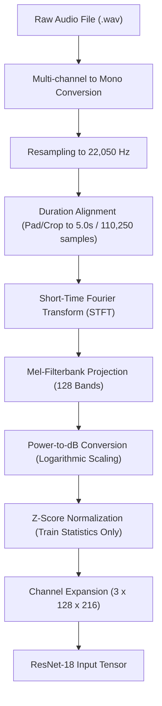

# SoundVision AI — Audio Preprocessing & Representation Engineering

## 1. Preprocessing Pipeline Overview

The acoustic preprocessing transforms continuous time-domain 1D pressure waveforms into calibrated 2D time-frequency energy representations suited for convolutional neural networks:

---

## 2. Parameter Specifications

| Parameter | Value | Justification |
|---|---:|---|
| **Target Sample Rate (`SAMPLE_RATE`)** | `22,050 Hz` | Nyquist limit of 11,025 Hz captures virtually all diagnostic acoustic energy for environmental sounds while drastically reducing computational overhead. |
| **FFT Size (`N_FFT`)** | `1024` | Yields a spectral frequency resolution of $\approx 21.5 \text{ Hz}$, providing sufficient separation of low-frequency engine drones and rumbling thunder. |
| **Hop Length (`HOP_LENGTH`)** | `512` | 50% window overlap provides a temporal frame rate of $\approx 43.1 \text{ frames/sec}$ ($23.2 \text{ ms}$ per frame). |
| **Mel Filter Banks (`N_MELS`)** | `128` | Perceptually scales frequency bands according to human auditory resolution, compacting high frequencies. |
| **Target Duration** | `5.0 seconds` | Standard ESC-50 length ($22050 \times 5 = 110,250 \text{ samples}$). |
| **Time Steps Output** | `216 frames` | Calculated via $\lfloor 110,250 / 512 \rfloor + 1 = 216$. |
| **Decibel Top Limit (`top_db`)** | `80.0 dB` | Dynamic range compression to suppress silent noise floor. |

---

## 3. Mel-Spectrogram Extraction Mathematics

1. **Short-Time Fourier Transform (STFT)**:
   $$X(m, k) = \sum_{n=0}^{N-1} x(n + mH) w(n) e^{-j 2\pi k n / N}$$
   where $w(n)$ is a Hann window, $H = 512$, and $N = 1024$.

2. **Power Spectrum**:
   $$P(m, k) = |X(m, k)|^2$$

3. **Mel-Scale Filterbank Mapping**:
   $$M(m, b) = \sum_{k=0}^{N/2} H_b(k) P(m, k) \quad (b = 1, \dots, 128)$$
   where $H_b(k)$ are triangular overlapping bandpass filters mapped across the Mel scale:
   $$m_{mel} = 2595 \log_{10}\left(1 + \frac{f}{700}\right)$$

4. **Logarithmic Decibel Scale**:
   $$S_{dB}(m, b) = 10 \log_{10}\left(\frac{\max(M(m, b), 10^{-10})}{\max(M)}\right)$$

---

## 4. Normalization & Data Leakage Prevention

Mel-spectrograms in decibel scale exhibit negative values spanning `[-80, 0] dB`. Feeding unnormalized values into networks pretrained on ImageNet (which expect values with zero mean and unit variance) causes massive distribution mismatch and numerical instability.

### Mathematical Formulation
$$x_{norm} = \frac{x - \mu_{train}}{\sigma_{train} + \epsilon}$$

Where:
- $\mu_{train} = \frac{1}{K} \sum_{i \in \text{Folds } 1-3} S_{dB}^{(i)}$
- $\sigma_{train} = \sqrt{\frac{1}{K} \sum_{i \in \text{Folds } 1-3} (S_{dB}^{(i)} - \mu_{train})^2}$
- $\epsilon = 10^{-7}$ prevents division by zero.

**Guarantee**: $\mu_{train}$ and $\sigma_{train}$ are calculated strictly once across the 240 training recordings. Validation and test samples are normalized using the fixed $\mu_{train}$ and $\sigma_{train}$.

---

## 5. Training-Time Data Augmentations

To combat overfitting on 240 training samples, we implement:
1. **SpecAugment Frequency Masking**: Randomly masks $f$ consecutive frequency channels with zeros ($f \in [0, 16]$).
2. **SpecAugment Time Masking**: Randomly masks $t$ consecutive time steps ($t \in [0, 24]$).
3. **Random Gain**: Applies a uniform gain modulation $g \in [-3.0, +3.0] \text{ dB}$.
4. **Time Shifting**: Circular roll of the waveform up to $\pm 10\%$ of total clip length.

*Augmentations are deactivated during validation, evaluation, and production inference.*
