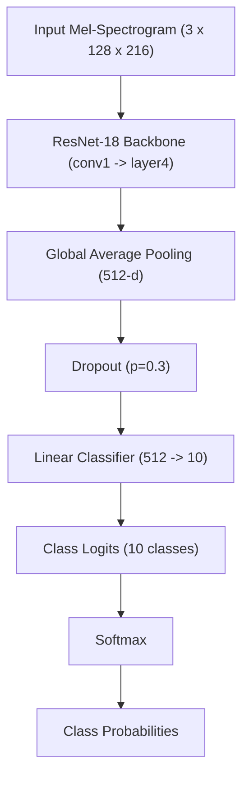

# SoundVision AI — Methodology & Technical Architecture

## 1. Deep Learning Paradigm

SoundVision AI frames environmental sound classification as a 2D vision transfer learning problem. By transforming 1D audio waveforms into log-Mel spectrograms, time-frequency sound representations exhibit visual-like structural motifs:
- **Harmonic sounds** (e.g. `dog`, `sheep`, `laughing`) appear as horizontal parallel frequency bands.
- **Impulsive sounds** (e.g. `fireworks`) appear as sharp vertical broadband spikes.
- **Turbulent noise** (e.g. `wind`, `airplane`, `thunderstorm`) appears as diffuse acoustic textures.

Convolutional backbones pretrained on natural images (ImageNet) have already acquired generalized hierarchical 2D feature extractors: early Gabor-like edge filters, texture detectors, and structural part combinations. Transfer learning allows high sample efficiency on modest audio datasets.

---

## 2. Model Architectures & Experimental Hypotheses

### Experiment A — Training From Scratch
- **Weights**: Random Kaiming normal initialization across all convolutional layers.
- **Backbone**: Fully trainable.
- **Hypothesis**: With only 240 training samples, the high parameter count ($\approx 11.2\text{M}$ parameters) will suffer severe overfitting and underperform pretrained representations.

### Experiment B — Linear Feature Extraction
- **Weights**: ResNet-18 pretrained on ImageNet-1K (`ResNet18_Weights.DEFAULT`).
- **Backbone**: Frozen (`requires_grad = False`).
- **Batch Normalization**: Kept in `eval()` mode.
- **Head**: Newly initialized `nn.Linear(512, 10)` trained with AdamW.
- **Hypothesis**: The frozen visual features provide a stable low-dimensional representation. However, domain divergence between natural photographs and acoustic spectrograms limits accuracy if backbone convolutional filters cannot adapt.

### Experiment C — End-to-End Fine-Tuning with Discriminative Learning Rates
- **Weights**: Pretrained on ImageNet-1K.
- **Backbone**: Fully trainable, but optimized with a lower learning rate ($\eta_{backbone} = 10^{-4}$).
- **Head**: Optimized with higher learning rate ($\eta_{head} = 10^{-3}$).
- **Regularization**: SpecAugment (time & frequency masking), weight decay ($10^{-4}$), label smoothing ($0.05$), gradient clipping ($\|g\|_2 \le 1.0$), and Cosine Annealing learning rate schedule.
- **Hypothesis**: Fine-tuning allows the convolutional kernels to adapt to spectrogram physics (e.g. anisotropic time-frequency patterns) while leveraging pretrained feature hierarchies, yielding the highest classification accuracy.

---

## 3. Optimization & Training Dynamics

### Discriminative Learning Rate Formulation
The model parameters $\Theta = \{\Theta_{backbone}, \Theta_{head}\}$ are optimized via AdamW with decoupled updates:
$$\Theta_{backbone}^{(t+1)} = \Theta_{backbone}^{(t)} - \eta_{b}^{(t)} \left( \frac{\hat{m}_t}{\sqrt{\hat{v}_t} + \epsilon} + \lambda \Theta_{backbone}^{(t)} \right)$$
$$\Theta_{head}^{(t+1)} = \Theta_{head}^{(t)} - \eta_{h}^{(t)} \left( \frac{\hat{m}_t}{\sqrt{\hat{v}_t} + \epsilon} + \lambda \Theta_{head}^{(t)} \right)$$
where $\eta_b = 0.1 \times \eta_h$, and $\eta^{(t)}$ decays according to:
$$\eta^{(t)} = \eta_{min} + \frac{1}{2}(\eta_{max} - \eta_{min})\left(1 + \cos\left(\frac{t}{T_{max}}\pi\right)\right)$$

### Exploding Loss Root Cause & Rectification
Historical experiments exhibited exploding loss in early iterations during feature extraction. Our investigation confirmed:
1. **Unnormalized Spectrogram Inputs**: Raw decibel values range from $-80$ to $0 \text{ dB}$. Feeding negative values with high absolute magnitude through BatchNorm layers with frozen ImageNet running statistics ($\mu \approx 0.45, \sigma \approx 0.22$) causes extreme activations and saturated softmax outputs.
2. **Proper BatchNorm Evaluation Mode**: When freezing the backbone, BatchNorm layers must remain in `eval()` mode (`track_running_stats=True` and no running mean updates) to avoid destabilizing batches.
3. **Z-Score Normalization**: Preprocessing now normalizes inputs using $\mu_{train}$ and $\sigma_{train}$, ensuring zero mean and unit variance.
